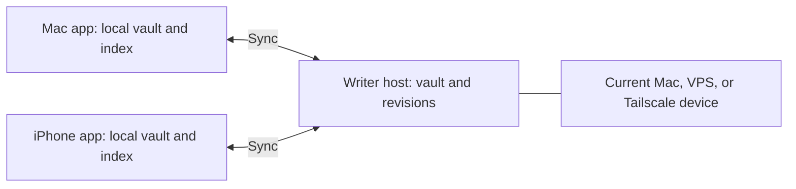

# Stack and architecture

## Selected direction

| Layer           | Choice                                                                                   |
| --------------- | ---------------------------------------------------------------------------------------- |
| Desktop         | Electron + React + TypeScript + Vite                                                     |
| Editor          | CodeMirror 6, with custom Live Preview and note extensions                               |
| Desktop styling | CSS Modules and shared semantic theme tokens                                             |
| Mobile          | React Native + Expo development builds                                                   |
| Mobile editor   | Shared CodeMirror editor in a locally bundled WebView, subject to real-device validation |
| Content         | Ordinary Markdown files and attachment files                                             |
| Local index     | SQLite with FTS5                                                                         |
| Host            | Node.js LTS + TypeScript + Fastify                                                       |
| Repository      | pnpm workspace                                                                           |

Electron supersedes the initial Tauri proposal. It provides a controlled Chromium runtime and greater sharing of Node filesystem/database code with the host. This is a development and consistency choice, not a claim that Electron or Tauri inherently provides faster typing.

The initial scaffold pins Node 24 and pnpm. Framework versions will be selected and pinned when app scaffolding begins.

## Topology



A local-only notebook needs no server. A synced notebook has one host for v1. The host coordinates accepted revisions; clients work offline with pending local changes. A sleeping/unreachable host delays sync, not editing.

The Mac host must support running independently of the app window. Exact background-service packaging is an implementation decision. Only one process should own mutation coordination for a given local vault; the desktop app and a co-located host must not operate as competing independent writers.

## Vault and supporting state

```text
Personal/
  Sunday thoughts.md
  Travel/
    Japan.md
  attachments/
    bookshop.jpg
  .writer/
    ...
```

Markdown and attachments are the portable content. Rebuildable SQLite indexes track search, links, and derived metadata. Durable state tracks file identities, pending operations, revision ancestry, deletion records, and history. These are different lifecycles even if an implementation uses SQLite for both.

The exact `.writer` layout is not finalized. Do not sync live database files, credentials, or per-device configuration as ordinary vault content. Back up both portable content and durable history/state.

File IDs should survive app-managed renames. External renames and duplicate files need an explicit identity strategy; path alone is insufficient and mandatory frontmatter IDs have not been selected.

## Local save pipeline

The editor owns immediate text interaction. A platform persistence layer durably records edits, performs atomic Markdown replacement where supported, and maintains a pending-sync queue. Filesystem changes and SQLite transactions are not one atomic transaction: use a recoverable operation journal and idempotent reconciliation.

Show Saved only after a durable local acknowledgment. Handle crash windows explicitly. External file changes are observed with watchers and reconciliation scans, and must not overwrite an in-memory dirty buffer silently.

Indexing, hashing, attachments, and sync run outside the interactive typing path. Desktop uses a separate process/worker for expensive work and a narrow typed IPC bridge. Mobile uses ordered edit batches and acknowledgments; it must not require a React Native round trip for every keystroke.

## Sync protocol direction

The protocol is now designed and built: see [sync](sync.md). The points below were the brief for it.

- HTTPS requests transfer saved revisions and fetch changes from a durable cursor.
- Each operation has an idempotency identity and a base revision.
- The host serializes accepted changes per notebook.
- Compare concurrent versions against a common ancestor. Merge non-overlapping edits; preserve both versions for overlapping changes.
- Represent deletion explicitly, including delete-versus-edit conflicts.
- Transfer attachments separately using hashes, integrity verification, and retryable uploads.
- Notifications can prompt a pull; the durable change log remains the source for recovery after missed notifications.
- Reconcile external host-side file edits through the same revision pipeline.

The wire format, merge library, cursor retention, tombstone collection, snapshot/rebootstrap rules, and host migration process need a protocol design before milestone 3. Returning offline devices must not resurrect old data when history is pruned.

This is revision-based personal-device sync. A CRDT and simultaneous multiplayer editing are outside v1.

## Security and pairing

Use short-lived single-use invitations to enroll a device, then issue revocable device credentials scoped to a notebook. Keep credentials in OS-protected storage where available. Tailscale provides connectivity; Writer authentication is still required.

Use HTTPS for public hosts and define certificate/trust setup for private hosts. Restrict filesystem access to the vault and reject path traversal and unsafe symlink escapes. Treat Markdown and attachment previews as untrusted content; keep Electron renderer isolation and expose only required operations.

The vault host can read its files. Transport encryption is planned; encryption that hides content from the host is not. A future agent on that host would also require explicit vault access.

## Mobile lifecycle

Sync on launch, resume, and while active. Background execution is best effort under iOS scheduling. A local notebook remains usable when the host is unavailable. Keep notes local; finalize attachment pinning/download policy before shipping.

## Package boundaries

- `core`: pure models, Markdown/link semantics, and platform interfaces.
- `editor`: browser editor behavior and commands.
- `sync`: shared protocol/state-machine rules using injected storage/transport.
- `theme`: semantic theme data.
- `desktop`, `mobile`, `host`: platform adapters and composition roots.

Extract shared Node storage code into a new package only when desktop and host implementations need it. Keep the public wire protocol versioned and usable by clients running different app versions.

## References

- [Electron process model](https://www.electronjs.org/docs/latest/tutorial/process-model)
- [Obsidian editor foundation](https://docs.obsidian.md/Plugins/Editor/Editor)
- [Obsidian decorations](https://docs.obsidian.md/Plugins/Editor/Decorations)
- [CodeMirror](https://codemirror.net/)
- [Expo SQLite](https://docs.expo.dev/versions/latest/sdk/sqlite/)
- [Expo filesystem](https://docs.expo.dev/versions/latest/sdk/filesystem/)
- [Expo background tasks](https://docs.expo.dev/versions/latest/sdk/background-task/)
- [Fastify](https://fastify.dev/docs/latest/)
